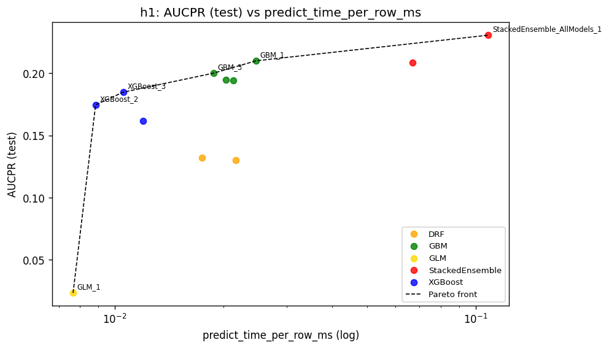
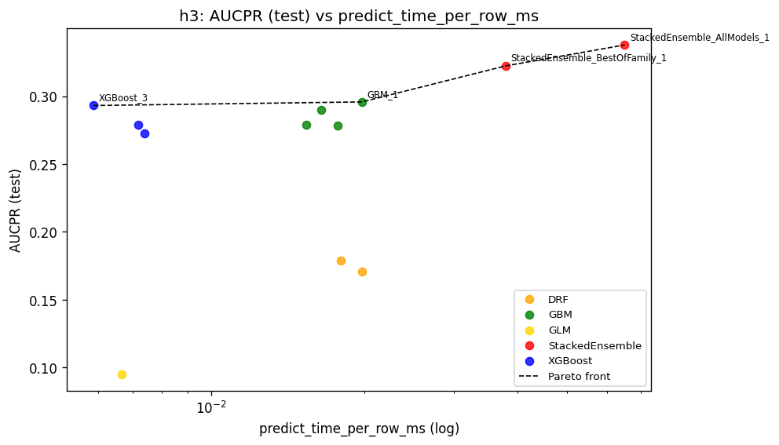
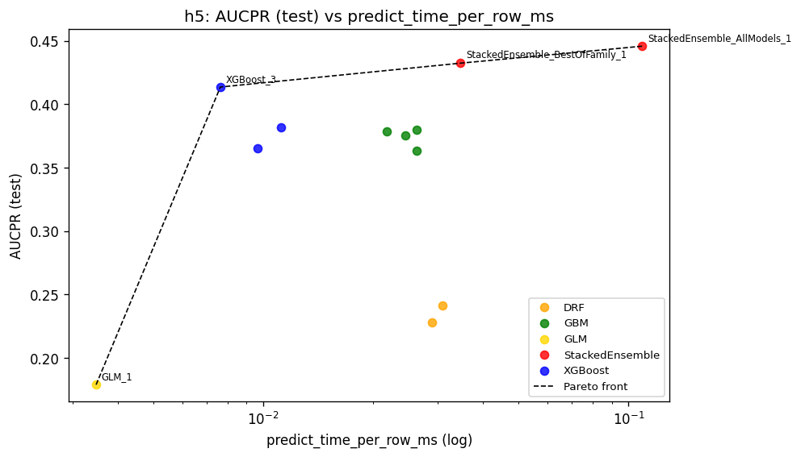
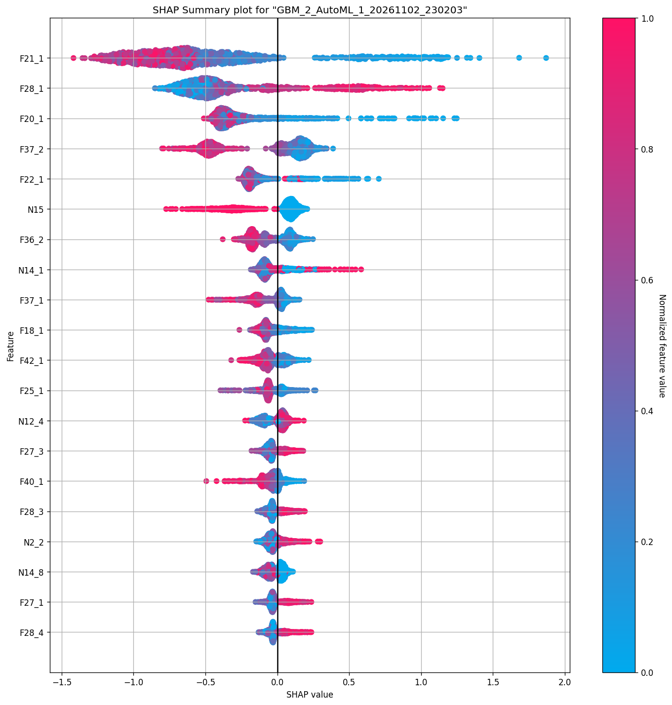
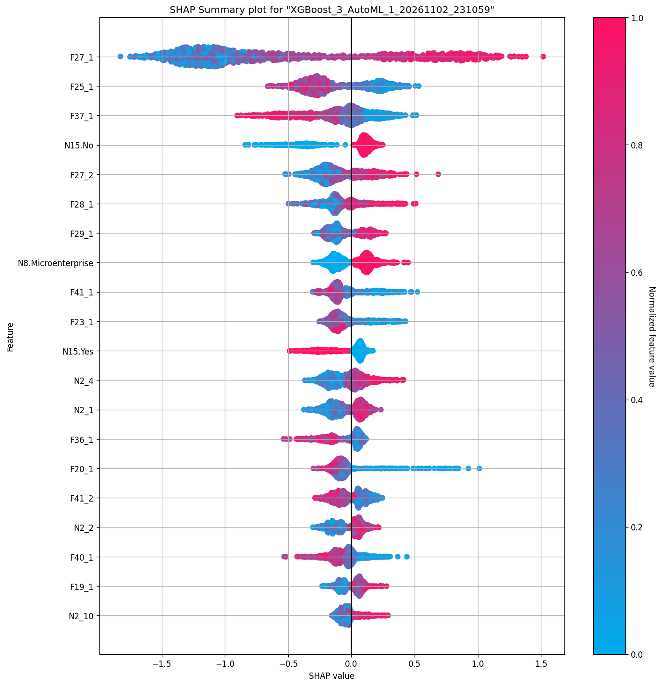
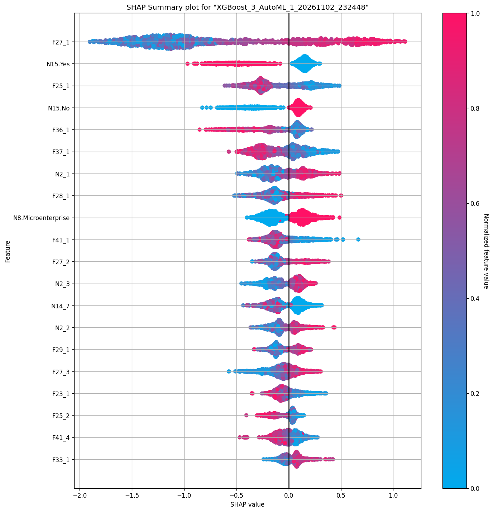

# Resultados: predicción de insolvencia con H2O AutoML (ejecución leak-free v3)

_Ejecución del 2026-11-02. Los resultados de ejecuciones anteriores (2023, leak-free v1 y v2) y el diagnóstico de por qué se descartaron están en `HISTORICO_EJECUCIONES.md`._

## 1. Resumen

- **Objetivo:** predecir si una pyme española será insolvente en los próximos h años (h = 1, 3 y 5) a partir de 10 años de historia económico-financiera, con un procedimiento libre de *data leakage*.
- **Datos:** `raw_data.csv` reconstruido en ventanas empresa-año, split por empresa 70/30 y test con la proporción real de insolvencias.
- **Mejor modelo en los tres horizontes:** `StackedEnsemble_AllModels`.

| Horizonte | AUC (CV) | AUC (test) | AUCPR (test) | Insolvencias en test | Recall / Precisión (umbral fijado en CV, §5.3) |
|---|---|---|---|---|---|
| h1 | 0,944 | 0,943 | 0,231 | 0,74 % | 0,43 / 0,23 |
| h3 | 0,916 | 0,921 | 0,338 | 2,35 % | 0,41 / 0,34 |
| h5 | 0,916 | 0,915 | 0,446 | 4,10 % | 0,46 / 0,45 |

- El rendimiento **baja con el horizonte**, como cabe esperar, y la validación cruzada coincide con el test, así que no hay sobreajuste.
- El AUCPR sube con h porque sube la proporción de insolvencias en test. Para comparar horizontes conviene mirar el AUC.
- **Mejor compromiso rendimiento/velocidad:** XGBoost_3 en h3 y h5 (predice entre 9 y 14 veces más rápido que el ensemble, con un AUCPR algo menor).
- **Variables más influyentes:** ratios financieros del último año. En h1 pesan la rentabilidad (F21, F20) y los gastos financieros sobre el activo (F28); en h3 y h5, la carga financiera (F27), la cobertura de intereses (F25) y la liquidez (F36 y F37).
- **Validación *out-of-time*** (corte 2014): AUC en test de 0,926 / 0,894 / 0,878 (ensemble h1/h3/h5). El *lift* sobre la prevalencia se mantiene; el AUC apenas cambia en empresas no vistas en train (§6.3).

## 2. Datos de partida

`/media/datos/WORKSPACE/DOCTORADO/datasets/raw_data.csv`: panel empresa-año.

| Característica | Valor |
|---|---|
| Filas (empresa-año) | 1.597.410 |
| Empresas (CIF) | 117.052 |
| Años | 1999–2020 |
| Variables | 43 explicativas (N1–N15 no financieras, F16–F43 financieras) + `FCA`, `Y` y `Type` |
| `Type` (nivel empresa) | Solvent: 58.528 empresas · Insolvent: 58.524 empresas |
| `Y` (nivel año) | 1 = año de la insolvencia (7.961 empresas, años 2008–2020) · 0 = año sin insolvencia · vacío en todas las filas de las empresas solventes |

Diccionario de variables: `Definicio_769_n_variables_independientes.docx`, donde la variable Xk corresponde a la columna Nk o Fk.

## 3. Procesamiento del dataset

El procesamiento se hace en dos scripts y sigue este principio: **todo lo que se aprende de los datos se aprende solo con train, y ninguna empresa se selecciona mirando su desenlace.**

| Paso | Script | Salida |
|---|---|---|
| Correcciones sobre el panel y construcción de ventanas | `scripts/01_build_windows_v2.py` (`VERSION='v3'`) | `data/windows/windows_v3_h{h}_unbalanced.pkl` |
| Split por empresa, preprocesamiento y balanceo de train | `scripts/02_split_preprocess_v2.py` (`VERSION='v3'`) | `data/final/{train_balanced,test_unbalanced}_leakfree_v3_h{h}.csv`, `data/splits/*_cifs_v3_h{h}.json` |

### 3.1 Corrección del cambio contable de 2008 (F27, F30, F42 y F43)

En 2008 entra en vigor el nuevo Plan General Contable (PGC 2007), y en todos los años anteriores **cuatro ratios aparecen con el signo invertido para todas las empresas**, solventes e insolventes. Por ejemplo, F43 (amortización / ventas) no puede ser negativo, pero lo es en el 89 % de las empresas en 2005–2007 y solo en el 1 % en 2008–2010.

Si no se corrige, el signo de estas variables identifica el periodo del dato, y por tanto la clase: las ventanas de insolventes incluyen más años anteriores a 2008. Es una fuga temporal.

**Corrección:** los valores de F27, F30, F42 y F43 anteriores a 2008 se multiplican por −1.

| Variable | Definición | Negativos antes de 2008 (original → corregido) | Negativos desde 2008 |
|---|---|---|---|
| F27 | (Capital + intereses) / Ventas | 78 % → 13 % | 0 % |
| F30 | Gastos financieros / Resultado del ejercicio | 78 % → 15 % | 29 % |
| F42 | Amortización técnica / EBIT | 79 % → 14 % | 27 % |
| F43 | Amortización técnica / Ventas | 90 % → 0 % | 0 % |

La corrección es exacta en F43 y aproximada en F27, que conserva un 13 % de valores negativos antes de 2008.

### 3.2 Variables eliminadas por reflejar la fuente de los datos

Una variable se elimina cuando su valor depende de **cómo se recogieron los datos de cada tipo de empresa** y no de la situación económica de la empresa. Si se mantuviera, el modelo aprendería a reconocer de qué fuente viene cada empresa, no su riesgo.

| Variable | Evidencia en `raw_data.csv` | Efecto si se mantiene |
|---|---|---|
| **FCA** (no está en el diccionario) | Ausente en el 100 % de las filas de solventes y en el 0 % de las de insolventes. Sus valores (mediana: 2013) son posteriores al año observado | Identifica directamente la clase |
| **N1** (antigüedad) | En el 28,9 % de las solventes N1 cuenta desde 1999 y se reinicia a 0 en la fecha de fundación (por ejemplo: 0, 1, …, 10 entre 1999 y 2009 y 0 en 2010). En las insolventes nunca ocurre | Mediana de "edad" de 12 años en solventes frente a 21 en insolventes por el reinicio, no por la edad real. En una ejecución de prueba acumulaba el 16–40 % de la importancia en h3/h5 |
| **N11** (sexo del CEO) | Ausente en el 67,6 % de las filas de insolventes frente al 7,9 % de las de solventes (años ≥ 2008) | El modelo usaba el indicador "N11 ausente" como señal de insolvencia (7–19 % de la importancia en la prueba) |

N11 no se puede imputar: la información está en el propio patrón de ausencia.

**Lo que no se elimina:** las filas de los años "anteriores a la fundación" de las solventes con N1 reiniciado (174.575 filas). Sus variables financieras varían de un año a otro y tienen la misma tasa de ausencia que el resto (8,2 % frente a 9,5 %), así que parecen datos reales. Lo que falla es solo el contador de edad, que ya se ha eliminado.

### 3.3 Construcción de ventanas empresa-año

Cada observación es una **ventana** `(CIF, t)` con los 10 años consecutivos `t−9 … t` de una empresa.

- **Variables temporales** (34): un valor por año, con sufijo de retardo: `F21_1` = año t (el más reciente), …, `F21_10` = año t−9. Incluyen las categóricas que cambian con el tiempo, N9 (auditada) y N10 (opinión de auditoría).
- **Variables estáticas** (5: N3 sector, N4 forma jurídica, N5 comercio exterior, N8 tamaño, N15 empresa familiar): último valor disponible hasta t.
- Solo se crean ventanas con los **10 años observados de forma consecutiva**. Como el panel empieza en 1999, todas las ventanas terminan en 2008 o después.
- Se conservan `CIF`, `window_id`, `ref_year` (= t) y `horizon` como identificadores. **No se usan como predictores.**

**Etiqueta Y para el horizonte h:**

| Regla | Motivo |
|---|---|
| Y = 1 si la empresa entra en insolvencia en el intervalo (t, t+h] | Definición estándar de horizonte de predicción |
| Se descartan las ventanas con t ≥ año de insolvencia | Verían la propia insolvencia |
| Y = 0 solo si la empresa sigue observada, sin insolvencia, hasta t+h | Si no, su estado en t+h es desconocido |
| Se exige t+h ≤ 2020 **para ambas clases** | Misma censura para positivos y negativos, para no introducir diferencias de calendario entre clases |
| Las empresas solventes (Y vacío en origen) cuentan como 0 | Nunca entran en insolvencia |
| **Las 50.563 empresas "Insolvent" sin año de insolvencia se mantienen** como negativas con la misma regla | Excluirlas supondría seleccionar la muestra según el desenlace (`Type`): los negativos quedarían limitados a empresas que nunca quiebran y las métricas saldrían optimistas. Si alguna etiqueta es errónea, el error hace las métricas más pesimistas, nunca más optimistas |

| | h1 | h3 | h5 |
|---|---|---|---|
| Ventanas | 487.110 | 376.635 | 278.464 |
| Empresas | 65.373 | 58.760 | 51.071 |
| Positivos (Y=1) | 3.622 (0,74 %) | 8.856 (2,35 %) | 11.551 (4,15 %) |
| `ref_year`: rango y mediana Y=0 / Y=1 | 2008–2019 · 2014 / 2012 | 2008–2017 · 2013 / 2011 | 2008–2015 · 2012 / 2011 |

### 3.4 Split por empresa (train 70 % / test 30 %)

- Se reparten **empresas, no filas**: todas las ventanas de un CIF van a train o todas a test, y se comprueba que no haya solapamiento.
- El reparto se estratifica según si la empresa tiene alguna ventana positiva, para mantener la proporción de insolvencias en ambos lados.
- Semilla: 1234. Listas de CIF guardadas en `data/splits/`.

| | h1 | h3 | h5 |
|---|---|---|---|
| Train: ventanas / empresas | 340.698 / 45.761 | 263.730 / 41.132 | 194.602 / 35.749 |
| Test: ventanas / empresas | 146.412 / 19.612 | 112.905 / 17.628 | 83.862 / 15.322 |
| Insolvencias en train / test | 0,74 % / 0,74 % | 2,35 % / 2,35 % | 4,17 % / 4,10 % |

### 3.5 Preprocesamiento ajustado solo con train

- **Variables con muchos valores ausentes:** se calcula el porcentaje medio de ausencia de cada variable base **solo en train**, y se eliminan las que superan el 50 %. Se eliminan **F26** (EBITDA / deuda comercial, 81–83 % ausente) y **F32** (deuda financiera / deuda comercial, 81–83 %). La misma eliminación se aplica después a test.
- **Sin imputación:** H2O trata los valores ausentes de forma nativa. Así se evita que un imputador ajustado con todos los datos filtre información de test, y que la ausencia de un dato se convierta en un valor artificial.
- **Sin escalado ni codificación manual:** H2O codifica internamente las categóricas.

### 3.6 Balanceo solo en train y folds por empresa

- **Undersampling 1:1 en train:** se conservan todos los positivos y se toma una muestra aleatoria de negativos del mismo tamaño (semilla 1234). **El test no se balancea**: mantiene la proporción real de insolvencias.
- **Columna `fold`:** asigna cada CIF a uno de 3 folds. AutoML la usa como `fold_column`, así que la validación cruzada nunca separa ventanas de una misma empresa.

| | h1 | h3 | h5 |
|---|---|---|---|
| Train balanceado (filas) | 5.070 | 12.410 | 16.230 |
| Empresas en train balanceado | 4.921 | 8.238 | 9.709 |
| Test (filas, sin balancear) | 146.412 | 112.905 | 83.862 |

### 3.7 Dataset final

351 columnas = 6 de identificación o control (`CIF`, `window_id`, `ref_year`, `horizon`, `Y`, `fold`) + **345 predictores**, construidos a partir de **39 variables base**:

| Tipo | Variables | Columnas |
|---|---|---|
| Estáticas no financieras | N3 sector, N4 forma jurídica, N5 comercio exterior, N8 tamaño, N15 empresa familiar | 5 |
| Temporales no financieras (×10 años) | N2 empleados, N6 incidencias judiciales, N7 accionistas, N9 auditada, N10 opinión de auditoría, N12 órganos sociales, N13 % de participación femenina, N14 días de retraso en presentar las cuentas | 90 |
| Temporales financieras (×10 años) | F16–F25, F27–F31, F33–F43 (25 ratios de rotación, rentabilidad, cobertura y coste de la deuda, endeudamiento, liquidez y amortización) | 250 |

Variables de `raw_data.csv` que **no** entran en el modelo: FCA, N1, N11 (§3.2) y F26, F32 (§3.5).

## 4. Configuración de AutoML

Script: `run_leakfree_python.py` (la `VERSION` por defecto es `v3`).

| Parámetro | Valor |
|---|---|
| H2O / Java | 3.40.0.4 / OpenJDK 17, 2 hilos, 4 GB |
| `max_models` / `max_runtime_secs` | 10 / 1800 por horizonte |
| Validación cruzada | `fold_column="fold"` (3 folds por CIF) |
| `sort_metric` | `AUCPR` |
| Algoritmos | GLM, DRF, XRT, GBM, XGBoost y StackedEnsemble (se excluye DeepLearning) |
| Semilla | 1234 |
| Evaluación | Todos los modelos sobre el test completo sin balancear |
| Explicaciones (SHAP, PDP, correlación) | Muestra aleatoria de unas 10.000 filas de test, sobre el mejor modelo de árboles (TreeSHAP no admite StackedEnsemble) |

### 4.1 Métricas de evaluación: AUC y AUCPR

El modelo asigna a cada empresa-año una probabilidad de insolvencia. Para cada umbral de corte se calculan:

- **Recall (sensibilidad)** = TP / (TP + FN): de las empresas que acaban siendo insolventes, qué fracción detecta el modelo.
- **Precisión** = TP / (TP + FP): de las empresas que el modelo marca como insolventes, qué fracción lo es de verdad.
- **Tasa de falsos positivos (FPR)** = FP / (FP + TN): qué fracción de las empresas solventes se marca por error.

El **AUC** es el área bajo la curva ROC (recall frente a FPR). Mide si el modelo **ordena** bien: la probabilidad de que una empresa insolvente elegida al azar reciba una puntuación más alta que una solvente elegida al azar. Un modelo aleatorio obtiene 0,5, sea cual sea la proporción de insolvencias.

El **AUCPR** es el área bajo la curva precisión-recall. Se puede leer como la **precisión media del modelo a lo largo de todos los niveles de recall**. Con un umbral alto se marcan pocas empresas (precisión alta, recall bajo); al bajarlo se detectan más insolvencias, pero entran más falsas alarmas.

**La referencia del AUCPR es la prevalencia, no 0,5.** Un modelo aleatorio obtiene un AUCPR igual a la proporción de positivos en los datos, así que el valor solo tiene sentido comparado con esa base:

| Horizonte | Prevalencia en test (= AUCPR de un modelo aleatorio) | AUCPR del líder | Mejora frente al azar |
|---|---|---|---|
| h1 | 0,74 % | 0,231 | ≈ 31× |
| h3 | 2,35 % | 0,338 | ≈ 14× |
| h5 | 4,10 % | 0,446 | ≈ 11× |

Por eso **no conviene comparar horizontes con el AUCPR**: sube con h porque hay más insolvencias en test, no porque el modelo mejore; de hecho, el AUC baja con h.

**Por qué el AUCPR complementa al AUC.** El AUC usa la FPR, que divide entre todas las empresas solventes. Como en test hay unas 145.000, la FPR puede ser muy pequeña aunque haya muchas falsas alarmas. Ejemplo con el líder de h1, con el umbral fijado en la validación cruzada (sección 5.3):

- falsos positivos: 1.566 de 145.325 negativos, una FPR del **1,1 %** (casi perfecto desde el punto de vista del AUC);
- pero el modelo marca 2.029 ventanas y solo **463 son insolventes**, una precisión del 23 %;
- detecta 463 de 1.087 insolvencias, un recall del 43 %.

Así, un AUC de 0,94 y un AUCPR de 0,23 son compatibles. El AUC indica que las insolventes quedan por encima de las solventes en el orden del modelo. El AUCPR indica si, en la parte alta de ese orden, las empresas marcadas son de verdad insolventes, que es lo que importa en la práctica cuando los positivos son raros.

**Cómo leer las métricas en este documento:**

1. **El AUCPR válido es el de test**, que conserva la prevalencia real. El AUCPR de validación cruzada del leaderboard se calcula sobre train balanceado 1:1 (referencia 0,5), así que sale mucho más alto. Sirve para ordenar los modelos entre sí (por eso es el `sort_metric`), pero no representa el uso real.
2. **El AUC sí es comparable entre CV y test y entre horizontes**, porque no depende de la prevalencia.
3. **Ni el AUC ni el AUCPR fijan un umbral**: resumen todos los umbrales a la vez. La matriz de confusión de la sección 5.3 usa el umbral que maximiza F1 (media armónica de precisión y recall), elegido en la validación cruzada de train y no en test. Si se prefiere detectar más insolvencias aunque haya que revisar más empresas, habría que elegir otro punto de la curva (ver sección 6).

## 5. Resultados

### 5.1 Ranking de familias de algoritmos

AUCPR en test del mejor modelo de cada familia:

| Algoritmo       |   Rank |     h1 |     h3 |     h5 |   Media |
|:----------------|-------:|-------:|-------:|-------:|--------:|
| StackedEnsemble |      1 | 0.2306 | 0.3378 | 0.4458 |  0.3381 |
| XGBoost         |      2 | 0.1847 | 0.2932 | 0.4136 |  0.2972 |
| GBM             |      3 | 0.2100 | 0.2958 | 0.3799 |  0.2952 |
| XRT             |      4 | 0.1299 | 0.1709 | 0.2412 |  0.1807 |
| DRF             |      5 | 0.1322 | 0.1787 | 0.2281 |  0.1796 |
| GLM             |      6 | 0.0232 | 0.0948 | 0.1790 |  0.0990 |

### 5.2 Leaderboards completos

Ordenados por AUCPR en CV. Los tiempos son los que mide H2O: entrenamiento total, y predicción en ms por fila.

#### h1
|   # | Modelo                         | Algoritmo       |   AUCPR (CV) |   AUC (CV) |   AUC (test) |   AUCPR (test) |   F1 (test) |   Entrenamiento (s) |   Predicción (ms/fila) |
|----:|:-------------------------------|:----------------|-------------:|-----------:|-------------:|---------------:|------------:|--------------------:|-----------------------:|
|   1 | StackedEnsemble_AllModels_1    | StackedEnsemble |       0.9401 |     0.9440 |       0.9431 |         0.2306 |      0.3129 |              5.0000 |                 0.1085 |
|   2 | StackedEnsemble_BestOfFamily_1 | StackedEnsemble |       0.9395 |     0.9430 |       0.9403 |         0.2087 |      0.3034 |              4.9000 |                 0.0669 |
|   3 | GBM_2                          | GBM             |       0.9345 |     0.9385 |       0.9355 |         0.1946 |      0.2887 |             10.4000 |                 0.0204 |
|   4 | GBM_1                          | GBM             |       0.9343 |     0.9388 |       0.9374 |         0.2100 |      0.2977 |             15.8000 |                 0.0247 |
|   5 | GBM_4                          | GBM             |       0.9331 |     0.9378 |       0.9339 |         0.1940 |      0.2845 |             14.7000 |                 0.0213 |
|   6 | XGBoost_1                      | XGBoost         |       0.9309 |     0.9345 |       0.9335 |         0.1615 |      0.2568 |              4.4000 |                 0.0120 |
|   7 | GBM_3                          | GBM             |       0.9309 |     0.9374 |       0.9342 |         0.2001 |      0.2928 |             11.7000 |                 0.0188 |
|   8 | XGBoost_3                      | XGBoost         |       0.9298 |     0.9351 |       0.9363 |         0.1847 |      0.2747 |              3.7000 |                 0.0106 |
|   9 | XGBoost_2                      | XGBoost         |       0.9282 |     0.9344 |       0.9329 |         0.1745 |      0.2623 |              5.8000 |                 0.0088 |
|  10 | DRF_1                          | DRF             |       0.9109 |     0.9198 |       0.9185 |         0.1322 |      0.2182 |              9.9000 |                 0.0174 |
|  11 | XRT_1                          | XRT             |       0.9072 |     0.9161 |       0.9124 |         0.1299 |      0.2240 |             15.0000 |                 0.0217 |
|  12 | GLM_1                          | GLM             |       0.7326 |     0.7849 |       0.7893 |         0.0232 |      0.0520 |              2.8000 |                 0.0077 |

#### h3
|   # | Modelo                         | Algoritmo       |   AUCPR (CV) |   AUC (CV) |   AUC (test) |   AUCPR (test) |   F1 (test) |   Entrenamiento (s) |   Predicción (ms/fila) |
|----:|:-------------------------------|:----------------|-------------:|-----------:|-------------:|---------------:|------------:|--------------------:|-----------------------:|
|   1 | StackedEnsemble_AllModels_1    | StackedEnsemble |       0.9084 |     0.9162 |       0.9208 |         0.3378 |      0.3772 |              7.6000 |                 0.0650 |
|   2 | StackedEnsemble_BestOfFamily_1 | StackedEnsemble |       0.9032 |     0.9122 |       0.9173 |         0.3224 |      0.3668 |              6.7000 |                 0.0379 |
|   3 | XGBoost_3                      | XGBoost         |       0.8962 |     0.9061 |       0.9112 |         0.2932 |      0.3492 |              9.7000 |                 0.0059 |
|   4 | GBM_1                          | GBM             |       0.8951 |     0.9039 |       0.9098 |         0.2958 |      0.3427 |             27.7000 |                 0.0198 |
|   5 | XGBoost_1                      | XGBoost         |       0.8945 |     0.9022 |       0.9056 |         0.2789 |      0.3329 |             17.8000 |                 0.0072 |
|   6 | XGBoost_2                      | XGBoost         |       0.8943 |     0.9032 |       0.9065 |         0.2725 |      0.3315 |             16.6000 |                 0.0074 |
|   7 | GBM_4                          | GBM             |       0.8938 |     0.9019 |       0.9059 |         0.2784 |      0.3334 |             29.5000 |                 0.0177 |
|   8 | GBM_3                          | GBM             |       0.8928 |     0.9019 |       0.9056 |         0.2901 |      0.3353 |             20.6000 |                 0.0164 |
|   9 | GBM_2                          | GBM             |       0.8927 |     0.9014 |       0.9059 |         0.2790 |      0.3350 |             16.6000 |                 0.0154 |
|  10 | DRF_1                          | DRF             |       0.8546 |     0.8710 |       0.8740 |         0.1787 |      0.2536 |             23.7000 |                 0.0180 |
|  11 | XRT_1                          | XRT             |       0.8503 |     0.8658 |       0.8690 |         0.1709 |      0.2448 |             23.0000 |                 0.0198 |
|  12 | GLM_1                          | GLM             |       0.7858 |     0.8166 |       0.8285 |         0.0948 |      0.1817 |             12.1000 |                 0.0067 |

#### h5
|   # | Modelo                         | Algoritmo       |   AUCPR (CV) |   AUC (CV) |   AUC (test) |   AUCPR (test) |   F1 (test) |   Entrenamiento (s) |   Predicción (ms/fila) |
|----:|:-------------------------------|:----------------|-------------:|-----------:|-------------:|---------------:|------------:|--------------------:|-----------------------:|
|   1 | StackedEnsemble_AllModels_1    | StackedEnsemble |       0.9081 |     0.9156 |       0.9155 |         0.4458 |      0.4579 |             10.8000 |                 0.1091 |
|   2 | StackedEnsemble_BestOfFamily_1 | StackedEnsemble |       0.9016 |     0.9103 |       0.9118 |         0.4324 |      0.4457 |              9.1000 |                 0.0346 |
|   3 | XGBoost_3                      | XGBoost         |       0.8946 |     0.9044 |       0.9076 |         0.4136 |      0.4447 |             14.7000 |                 0.0076 |
|   4 | XGBoost_2                      | XGBoost         |       0.8943 |     0.9027 |       0.9004 |         0.3817 |      0.4202 |             22.3000 |                 0.0112 |
|   5 | GBM_1                          | GBM             |       0.8905 |     0.8996 |       0.8991 |         0.3799 |      0.4110 |             43.5000 |                 0.0263 |
|   6 | GBM_2                          | GBM             |       0.8903 |     0.8974 |       0.8992 |         0.3788 |      0.4145 |             19.9000 |                 0.0218 |
|   7 | XGBoost_1                      | XGBoost         |       0.8899 |     0.9000 |       0.9014 |         0.3656 |      0.4123 |             24.5000 |                 0.0096 |
|   8 | GBM_3                          | GBM             |       0.8894 |     0.8974 |       0.8978 |         0.3756 |      0.4060 |             26.1000 |                 0.0244 |
|   9 | GBM_4                          | GBM             |       0.8873 |     0.8960 |       0.8960 |         0.3636 |      0.4021 |             37.7000 |                 0.0263 |
|  10 | XRT_1                          | XRT             |       0.8397 |     0.8546 |       0.8614 |         0.2412 |      0.3130 |             28.9000 |                 0.0310 |
|  11 | DRF_1                          | DRF             |       0.8392 |     0.8550 |       0.8578 |         0.2281 |      0.3102 |             21.6000 |                 0.0290 |
|  12 | GLM_1                          | GLM             |       0.7338 |     0.7697 |       0.8293 |         0.1790 |      0.2828 |              2.8000 |                 0.0035 |

### 5.3 Matriz de confusión del líder en test

Script: `scripts/03_threshold_fp_analysis.py`. Resultados en `runs/leakfree_v3_h{h}/leader_thresholds_h{h}.csv`, `leader_false_positives_h{h}.csv` y `leader_test_predictions_h{h}.csv`.

#### Elección del umbral sin mirar el test

El umbral se fija con la **validación cruzada del líder en train** (folds por empresa) y se aplica al test sin cambios. Como train está balanceado 1:1, la tabla de umbrales de la CV se repondera a la prevalencia real de train. Los negativos se submuestrearon al azar con una tasa β = n.º de positivos / n.º de negativos (0,0075 en h1, 0,0241 en h3 y 0,0435 en h5), así que cada falso positivo de la CV equivale a 1/β falsos positivos reales. Se elige el umbral que maximiza el F1 reponderado.

| h | Umbral | TP | FP | FN | TN | Alertas | Recall | Precisión | F1 |
|---|---|---|---|---|---|---|---|---|---|
| h1 | 0,944 | 463 | 1.566 | 624 | 143.759 | 2.029 | 0,426 | 0,228 | 0,297 |
| h3 | 0,903 | 1.078 | 2.055 | 1.573 | 108.199 | 3.133 | 0,407 | 0,344 | 0,373 |
| h5 | 0,890 | 1.591 | 1.926 | 1.845 | 78.500 | 3.517 | 0,463 | 0,452 | 0,458 |

Con este umbral el modelo **detecta entre el 41 % y el 46 % de las insolvencias y acierta entre el 23 % y el 45 % de sus alertas**. Frente a dar alertas al azar, la precisión es unas 31 veces mayor en h1, 15 en h3 y 11 en h5.

Comparación con otros criterios de umbral:

| h | Criterio | Recall | Precisión | F1 |
|---|---|---|---|---|
| h1 | CV reponderada (**el que se usa**) | 0,426 | 0,228 | 0,297 |
| h1 | F1 máx. en test (optimista) | 0,342 | 0,283 | 0,310 |
| h1 | F1 máx. en CV balanceada, sin reponderar | 0,916 | 0,036 | 0,068 |
| h3 | CV reponderada (**el que se usa**) | 0,407 | 0,344 | 0,373 |
| h3 | F1 máx. en test (optimista) | 0,426 | 0,338 | 0,377 |
| h3 | F1 máx. en CV balanceada, sin reponderar | 0,899 | 0,091 | 0,165 |
| h5 | CV reponderada (**el que se usa**) | 0,463 | 0,452 | 0,458 |
| h5 | F1 máx. en test (optimista) | 0,464 | 0,450 | 0,457 |
| h5 | F1 máx. en CV balanceada, sin reponderar | 0,874 | 0,154 | 0,261 |

- **El sesgo optimista de elegir el umbral en test es pequeño**: el F1 baja como mucho 0,013 (en h1), y en h3 y h5 apenas cambia. En h1 el umbral sin test da más alertas: más recall (43 % frente a 34 %) y menos precisión (23 % frente a 28 %).
- **No se puede usar el umbral de la CV balanceada tal cual.** El modelo se entrenó con un 50 % de positivos, y sus probabilidades están infladas respecto a la prevalencia real. Ese umbral marcaría unas 28.000 ventanas en h1 con una precisión del 3,6 %. La reponderación por β corrige este problema.
- Las cifras de "F1 máx. en test" difieren ligeramente de las que daba H2O directamente (381 TP y 967 FP en h1) porque H2O calcula los umbrales sobre histogramas aproximados. La conclusión no cambia.

#### ¿Quiénes son los falsos positivos?

Para cada ventana de test (empresa, año t) marcada como insolvente pero con Y = 0, se mira en `raw_data.csv` qué le pasa después a la empresa (umbral sin test):

| Situación real de la empresa | h1: FP | h1: % de FP | h3: % de FP | h5: % de FP | % entre los verdaderos negativos (h1 / h3 / h5) |
|---|---|---|---|---|---|
| Quiebra 1–2 años después del horizonte | 186 | 11,9 % | 10,1 % | 8,6 % | 1,0 / 0,9 / 0,6 % |
| Quiebra 3 o más años después del horizonte | 77 | 4,9 % | 6,2 % | 5,9 % | 1,4 / 0,9 / 0,5 % |
| `Type = Insolvent` sin año de quiebra en el panel | 785 | 50,1 % | 37,7 % | 29,2 % | 7,8 / 5,1 / 3,1 % |
| `Type = Solvent` | 518 | 33,1 % | 46,0 % | 56,3 % | 89,8 / 93,2 / 95,8 % |

Las empresas solventes son el 90–96 % de los verdaderos negativos, pero solo el 33–56 % de las falsas alarmas. **La mayoría de las falsas alarmas recaen en empresas que sí tienen problemas**:

- Entre un 14 % y un 17 % de los falsos positivos **quiebran más tarde**, fuera del horizonte. En h1, el modelo marca al 11 % de las ventanas de empresas que quiebran 1–2 años después del horizonte, frente al 0,4 % de las ventanas de empresas solventes. Son alertas tempranas más que errores.
- Entre un 29 % y un 50 % son empresas **clasificadas como insolventes en la fuente** pero sin año de quiebra en el panel.

Si se cuentan como alertas justificadas las de empresas que quiebran más tarde, la precisión pasa del 23 % al **36 %** en h1, del 34 % al **45 %** en h3 y del 45 % al **53 %** en h5. Si se añaden también las insolventes sin fecha, sube al 74 %, 70 % y 69 %.

**Cautela con las insolventes sin fecha.** No sabemos si o cuándo quebraron, y la sección 6 recoge indicios de que solventes e insolventes vienen de fuentes distintas. Parte de las alertas sobre estas empresas podría deberse a que el modelo reconoce la fuente y no el deterioro financiero. Por eso la cifra prudente es la que solo añade las quiebras posteriores (36 % / 45 % / 53 %).

**Lectura para el paper.** Con un umbral elegido sin mirar el test, el modelo acierta entre 1 de cada 4 y 1 de cada 2 alertas, según el horizonte, cuando el azar acertaría entre 1 de cada 135 y 1 de cada 24. Además, una parte relevante de las alertas "fallidas" corresponde a empresas que quiebran poco después del horizonte. Es una cifra buena para un sistema de cribado o de alerta temprana, aunque insuficiente para decidir de forma automática sin revisión.

### 5.4 Frentes de Pareto: rendimiento frente a velocidad

Modelos no dominados (ninguno es a la vez más rápido y mejor), ordenados del más rápido al de mayor rendimiento:

- **h1**: AUC CV vs predicción: GLM_1 → XGBoost_2 → XGBoost_3 → GBM_3 → GBM_2 → GBM_1 → StackedEnsemble_BestOfFamily_1 → StackedEnsemble_AllModels_1; AUCPR test vs predicción: GLM_1 → XGBoost_2 → XGBoost_3 → GBM_3 → GBM_1 → StackedEnsemble_AllModels_1; AUCPR test vs entrenamiento: GLM_1 → XGBoost_3 → StackedEnsemble_BestOfFamily_1 → StackedEnsemble_AllModels_1
- **h3**: AUC CV vs predicción: XGBoost_3 → StackedEnsemble_BestOfFamily_1 → StackedEnsemble_AllModels_1; AUCPR test vs predicción: XGBoost_3 → GBM_1 → StackedEnsemble_BestOfFamily_1 → StackedEnsemble_AllModels_1; AUCPR test vs entrenamiento: StackedEnsemble_BestOfFamily_1 → StackedEnsemble_AllModels_1
- **h5**: AUC CV vs predicción: GLM_1 → XGBoost_3 → StackedEnsemble_BestOfFamily_1 → StackedEnsemble_AllModels_1; AUCPR test vs predicción: GLM_1 → XGBoost_3 → StackedEnsemble_BestOfFamily_1 → StackedEnsemble_AllModels_1; AUCPR test vs entrenamiento: GLM_1 → StackedEnsemble_BestOfFamily_1 → StackedEnsemble_AllModels_1

- En **h3 y h5**, **XGBoost_3** es el mejor compromiso: AUCPR en test de 0,29 y 0,41, frente a 0,34 y 0,45 del ensemble, con una predicción entre 9 y 14 veces más rápida (0,006–0,008 frente a 0,065–0,109 ms/fila).
- En **h1** el ensemble aventaja más claramente a los modelos individuales (AUCPR 0,231 frente a 0,210 de GBM_1).
- GLM está en el frente solo por ser el más rápido. Su rendimiento queda muy por debajo.

**h1**

**h3**

**h5**

### 5.5 Importancia de variables

Importancia del mejor modelo de árboles de cada horizonte:

- **h1 (GBM_2)**: F21_1 (27.7%), F28_1 (15.3%), F20_1 (7.4%), F22_1 (3.0%), F37_2 (2.5%), F36_2 (1.5%), F25_1 (1.5%), F42_1 (1.0%) | por variable base: F21 29.2%, F28 18.4%, F20 8.6%, F37 4.1%, F22 3.4%, N12 2.9%
- **h3 (XGBoost_3)**: F27_1 (24.0%), F25_1 (5.0%), F41_1 (4.3%), F29_1 (3.6%), F28_1 (3.0%), F37_1 (2.5%), F20_1 (2.3%), N15.No (2.1%) | por variable base: F27 27.5%, F25 6.1%, F41 6.0%, N2 5.4%, F29 4.7%, F28 3.9%
- **h5 (XGBoost_3)**: F27_1 (14.5%), F25_1 (10.3%), F29_1 (5.1%), F28_1 (3.3%), F37_1 (2.9%), N2_1 (2.3%), F41_1 (2.3%), F36_1 (2.2%) | por variable base: F27 18.5%, F25 11.8%, N2 7.0%, F29 6.9%, F28 4.4%, F41 4.3%

| Horizonte | Variables dominantes | Interpretación |
|---|---|---|
| h1 | F21 rentabilidad de explotación, F28 gastos financieros / activo, F20 rentabilidad económica | A un año, la señal es la rentabilidad y el peso de la deuda en el último ejercicio |
| h3 | F27 carga financiera ((capital + intereses) / ventas), F25 cobertura de intereses (EBIT / gastos financieros), F41 cash-flow / ventas | A medio plazo domina la capacidad de atender la deuda |
| h5 | F27, F25, F29 gastos financieros / ventas, N2 empleados, F28 | Igual que h3, con más peso del tamaño de la empresa |

Más de la mitad de la importancia corresponde al **último año** (sufijo `_1`): 63 % en h1, 55 % en h3 y 52 % en h5. El año anterior (`_2`) aporta un 8–11 %, y cada uno de los años más antiguos menos del 7 %. Cuanto más largo es el horizonte, más peso tienen los años anteriores al último.

SHAP summary del mejor modelo de árboles (cada punto es una ventana de test; el color indica el valor de la variable: rojo alto, azul bajo):

**h1**

**h3**

**h5**

### 5.6 Gráficos generados

Todos están en `runs/leakfree_v3_h{h}/plots/`. Para SHAP, PDP, importancia y curva de aprendizaje se usa el mejor modelo de árboles de cada horizonte: GBM_2 en h1 y XGBoost_3 en h3 y h5.

| Gráfico | Fichero |
|---|---|
| Pareto AUC (CV) frente a tiempo de predicción (equivalente al de 2023) | `pareto_auc_cv_vs_predict_time.png` |
| Pareto AUCPR (test) frente a tiempo de predicción | `pareto_aucpr_test_vs_predict_time.png` |
| Pareto AUCPR (test) frente a tiempo de entrenamiento | `pareto_aucpr_test_vs_training_time.png` |
| Importancia de variables (top 20) | `<modelo>_varimp.png` |
| Heatmap de importancia entre modelos | `varimp_heatmap.png` |
| SHAP summary | `<modelo>_shap_summary.png` |
| SHAP de una empresa insolvente | `<modelo>_shap_row_insolvent.png` |
| Dependencia parcial (PDP) de las 5 variables principales | `<modelo>_pdp_<variable>.png` |
| Curva de aprendizaje del líder y del mejor modelo de árboles | `leader_learning_curve.png`, `<modelo>_learning_curve.png` |
| Correlación entre las predicciones de los modelos | `model_correlation.png` |
| Coeficientes del metalearner del ensemble | `metalearner_std_coef.png` |

Ficheros de datos de cada `runs/leakfree_v3_h{h}/`:
- `*_leaderboard.csv`: leaderboard con tiempos;
- `*_test_metrics.csv`: métricas de test;
- `*_pareto_*.csv`: modelos de cada frente;
- `*_varimp.csv`: importancia de variables;
- `*_leader_confusion_matrix_test.csv`: matriz de confusión del líder;
- `*_metalearner_coef_norm.json`: coeficientes del metalearner;
- además, los modelos binarios y el MOJO del líder.

## 6. Análisis complementarios

Scripts en `scripts/04_*`–`07_*`; salidas en `runs/leakfree_v3_extra/` y `runs/leakfree_v3oot_h{h}/`.

### 6.1 Composición por sector y tamaño (`04_dataset_composition.py`)

El split por empresa conserva la composición: train y test difieren en menos de 1 punto porcentual en sector y tamaño en los tres horizontes. Detalle en `composition_h{h}.csv` y `composition_summary.md`.

| % de ventanas (h1) | Total | Train | Test |
|---|---|---|---|
| Servicios | 51,6 | 51,4 | 51,9 |
| Industria | 25,1 | 25,1 | 25,0 |
| Construcción | 22,2 | 22,3 | 22,1 |
| Agricultura | 1,2 | 1,2 | 1,0 |
| Microempresa | 49,2 | 49,2 | 49,3 |
| Pequeña | 39,8 | 39,8 | 39,8 |
| Mediana | 11,0 | 11,0 | 10,9 |

h3 y h5 muestran el mismo patrón (servicios ≈ 51 %, microempresas ≈ 48 %).

### 6.2 Importancia por permutación (`05_permutation_importance.py`)

Modelos seleccionados (GBM_2 en h1, XGBoost_3 en h3 y h5) sobre el test completo. Métrica: caída de AUCPR al permutar cada columna, media de 3 repeticiones.

| h | AUCPR base | Top 5 columnas (caída de AUCPR) | Top variables base (% de la caída total) |
|---|---|---|---|
| 1 | 0,195 | F21_1 0,080 · F20_1 0,041 · F42_1 0,017 · F37_1 0,017 · F28_1 0,016 | F21 11,6 · F20 7,2 · F28 4,7 · F37 4,3 · F40 4,3 |
| 3 | 0,293 | F27_1 0,092 · N15 0,027 · F20_1 0,022 · F25_1 0,021 · F40_1 0,020 | F27 22,2 · F25 6,1 · F20 5,6 · N15 5,2 · F40 4,9 |
| 5 | 0,414 | F27_1 0,167 · N15 0,035 · N8 0,016 · F27_2 0,015 · F28_1 0,015 | F27 36,4 · N15 6,2 · F33 5,0 · F25 4,2 · N2 4,1 |

La variable dominante coincide con la importancia nativa de H2O: F21 en h1 y F27 en h3 y h5. La permutación sube a N15 (empresa familiar) al 2.º puesto en h3 y h5; ver limitación 1.

### 6.3 Validación *out-of-time* (`06_oot_split.py`, `07_oot_unseen_eval.py`)

**Diseño:**
- Corte C = 2014, común a los tres horizontes.
- Train: ventanas con la etiqueta observable en el corte (`ref_year + h ≤ 2014`).
- Test: ventanas con `ref_year ≥ 2014`, todas las empresas.
- Mismo preprocesamiento y configuración de AutoML que v3 (`LEAKFREE_VERSION=v3oot`). Se eliminan las mismas variables (F26, F32).

| h | Train: años · ventanas · positivos | Test: años · ventanas · positivos · prevalencia | Test, empresas no vistas: ventanas · positivos |
|---|---|---|---|
| 1 | 2008–2013 · 223.014 · 2.400 | 2014–2019 · 264.096 · 1.222 · 0,46 % | 50.083 · 259 |
| 3 | 2008–2011 · 134.036 · 4.793 | 2014–2017 · 167.652 · 2.234 · 1,33 % | 49.912 · 641 |
| 5 | 2008–2009 · 60.708 · 3.844 | 2014–2015 · 79.678 · 1.789 · 2,25 % | 31.546 · 601 |

**Split por empresa (v3) frente a split temporal (v3oot)**, test. *Lift* = AUCPR ÷ prevalencia.

| h | Modelo | AUC v3 | AUC oot | AUCPR v3 | AUCPR oot | *Lift* v3 | *Lift* oot |
|---|---|---|---|---|---|---|---|
| 1 | SE_All | 0,943 | 0,926 | 0,231 | 0,158 | 31× | 34× |
| 1 | GBM_2 | 0,936 | 0,919 | 0,195 | 0,126 | 26× | 27× |
| 3 | SE_All | 0,921 | 0,894 | 0,338 | 0,207 | 14× | 16× |
| 3 | XGBoost_3 | 0,911 | 0,879 | 0,293 | 0,181 | 12× | 14× |
| 5 | SE_All | 0,916 | 0,878 | 0,446 | 0,280 | 11× | 12× |
| 5 | XGBoost_3 | 0,908 | 0,862 | 0,414 | 0,235 | 10× | 10× |

**Test temporal por tipo de empresa** (AUC / *lift*):

| h | Modelo | Vistas en train | No vistas |
|---|---|---|---|
| 1 | SE_All | 0,929 / 37× | 0,916 / 25× |
| 1 | GBM_2 | 0,921 / 29× | 0,908 / 21× |
| 3 | SE_All | 0,894 / 16× | 0,896 / 15× |
| 3 | XGBoost_3 | 0,879 / 14× | 0,878 / 13× |
| 5 | SE_All | 0,880 / 13× | 0,874 / 11× |
| 5 | XGBoost_3 | 0,868 / 11× | 0,851 / 9× |

**Lectura:**
- El AUC cae entre 0,017 (h1) y 0,038 (h5). La caída crece con el horizonte; en h5 se entrena solo con 2008–2009.
- El AUCPR baja sobre todo porque la prevalencia del test es casi la mitad. Ajustado por prevalencia, el *lift* se mantiene o sube.
- El ranking de familias es el mismo que en v3: SE > GBM/XGBoost > DRF/XRT > GLM.
- Aparece una brecha CV–test (h1: AUC 0,944 frente a 0,926) que no existía en v3. Es la señal esperable de *drift* temporal.
- En empresas no vistas el AUC prácticamente no cambia. El *lift* baja algo en h1 (25× frente a 37×, con solo 259 positivos) y en h5.

## 7. Limitaciones y puntos pendientes

1. **N15 (empresa familiar)** puede ser en parte un artefacto de la fuente: "Sí" aparece en el 30,7 % de las filas de solventes, el 15,2 % de las insolventes con fecha y solo el 3,5 % de las insolventes sin fecha. Se mantiene porque también hay un efecto real documentado, pero convendría comprobar cómo se obtuvo.
2. **N14 (días de retraso en presentar las cuentas)** cambia de nivel entre periodos (mediana de 47 → 74 días entre 2005–07 y 2008–10). En esta ejecución tiene poco peso (≈ 2 %).
3. **La corrección de signo de F27** es aproximada: quedan un 13 % de valores negativos antes de 2008, frente al 0 % después.
4. **Calendario:** las ventanas positivas son algo más antiguas (mediana de `ref_year` 2011–2012 frente a 2012–2014). `ref_year` no se usa como predictor. La validación *out-of-time* (§6.3) muestra que el rendimiento discriminante se mantiene en años posteriores (AUC 0,86–0,93) con una degradación moderada que crece con el horizonte.
5. **Origen de `raw_data.csv`:** varios artefactos (FCA, N1, N11, insolventes sin fecha) indican que solventes e insolventes se extrajeron por vías distintas. Conviene documentar cómo se construyó el fichero.
6. **Umbral de decisión:** §5.3 usa el umbral de F1 máximo elegido en la CV de train (sin mirar test). Para un uso concreto habría que fijarlo según el coste relativo de no detectar una insolvencia frente al de una falsa alarma.
